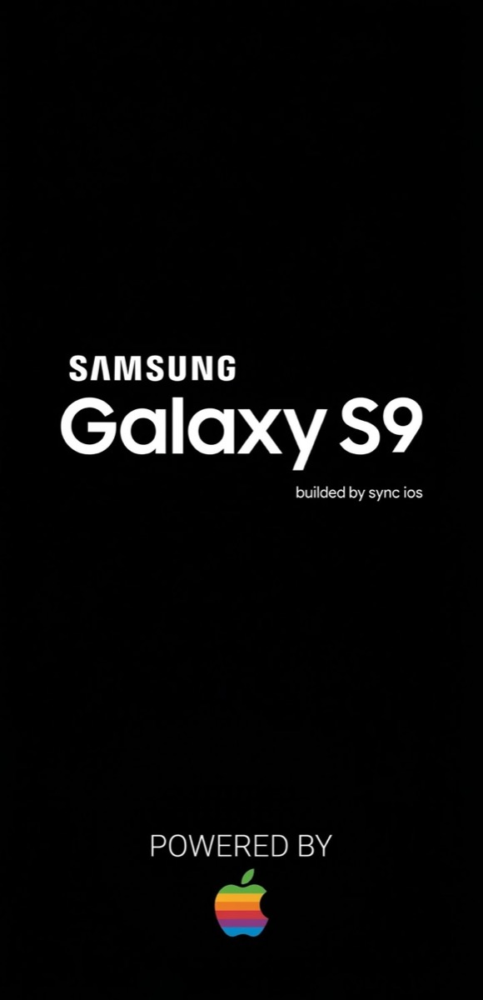

<div align="center">



# ios-s9

**iOS 14.3 on the Samsung Galaxy S9.**

Apple's open-source XNU, booted bare-metal on a Snapdragon 845 phone.

<sub>Hobby research. Not affiliated with Apple or Samsung. No Apple binaries are distributed here.</sub>

</div>

---

## What this is

A port of **iOS 14.3 (18C66)** to the Snapdragon Galaxy S9 (`starqltechn`, SM-G9600,
SDM845). Apple's open-source **xnu-7195** — the iOS 14.3 kernel generation — runs on the
bare metal, and on top of it the unmodified iPhone XR iOS 14.3 userland: launchd, the
system daemons, backboardd, SpringBoard.

The phone boots from Samsung's own bootloader. Nothing about the hardware is emulated.

> **Status: bring-up, not a usable phone.** The kernel reaches userspace and SpringBoard
> stays alive, but it does not draw yet. See [Where it stands](#where-it-stands).

## Where it stands

| Area | State |
| --- | --- |
| Boot | Samsung ABL → our shim in the `boot` partition → XNU. Flashed from TWRP with `dd` + readback |
| CPU | All 8 cores (4× Cortex-A55 + 4× Cortex-A75), PSCI, GIC-600, 16 KB pages |
| RAM | ~3.4 GiB for iOS; Qualcomm's carve-outs inside the range are kept off the free list |
| Storage | Own UFS host driver; the iOS root is an HFS+ volume in `userdata`, read/write |
| Kernel | launchd + ~47 daemons, `Early boot complete` in about 3 s |
| Display | 1440×2960 command-mode AMOLED. Kernel IOSurface + IOMobileFramebuffer (`AppleCLCD`) services exist; the panel is not driven yet |
| Touch / keys | Samsung `sec_ts` over I²C bit-bang; power and volume keys |
| Network | USB CDC-ECM (the PC shares its connection), SSH as root |
| **Not working** | **The GUI does not draw.** Wi-Fi, Bluetooth, cellular, GPU, camera, sensors |

### The open blocker

```
containermanagerd  → 60 XPC queries to usermanagerd, gives up, SIGTRAP at +0x6580
                   → no MCM container answers
                   → BSSystemSharedResourcesDirectory() = nil
                   → backboardd aborts in -[NSURL initFileURLWithPath:]
                   → SpringBoard runs, but draws nothing
```

In 14.3 the `usermanagerd` service *is* keybagd — there is no separate binary. The
kernel-side persona syscalls are not in this loop: the only symbol `containermanagerd`
imports is `_kpersona_info`; everything else goes over XPC.

`MKB_INIT` does complete and the personas are created (verified in all five persistent
logs). The failure is downstream of that. The next boot is instrumented to say which
half: `PGET`/`PFIND` now print per process, so `containermanagerd`'s own view of its
persona is the first thing the log will show.

## How it boots

```
Samsung ABL (stock bootloader, unlocked)
  -> our shim in the boot partition
     -> own MMU setup, reads the live FDT, loads the payload
        -> XNU Mach-O + generated Apple Device Tree + boot-args
           -> XNU -> UFS driver -> HFS+ root in userdata
              -> dyld + shared cache -> launchd -> daemons -> backboardd + SpringBoard
```

There is no serial port on this board. The kernel draws its console into the framebuffer
ABL leaves behind, and keeps a persistent log ring at the end of `userdata` that survives
a reset — that ring is how every boot is diagnosed, without filming the screen.

## Repository layout

| Path | What |
| --- | --- |
| `s9/shim/` | Bare-metal boot shim (C + asm), packed as an Android boot.img v2. Stages `m1`…`m12` |
| `s9/tools/` | Device tree builder, payload packer, flashing, log reading, profiling |
| `s9/build.sh` | Builds the shim for a given stage |
| `xnu/patches-7195/` | **The kernel we run**: xnu-7195 (iOS 14.3) as a snapshot diff + new files |
| `xnu/patches/` | The earlier xnu-8796 (iOS 16) patch series, kept for reference |
| `s9/NOTES.md` | The engineering log: every boot, crash and decision (Portuguese) |
| `docs/` | Artwork |

## Building it

You need a Snapdragon Galaxy S9 (SM-G9600) with an unlocked bootloader and TWRP, a Mac or
Linux host, and the iOS 14.3 (18C66) iPhone XR root filesystem, which you obtain yourself.

**1. The kernel.** Rebuild Apple's xnu-7195 and apply this tree:

```sh
curl -LO https://opensource.apple.com/tarballs/xnu/xnu-7195.141.2.tar.gz
tar xzf xnu-7195.141.2.tar.gz && cd xnu-7195.141.2
tar xzf /path/to/xnu/patches-7195/new-files.tar.gz
for p in /path/to/xnu/patches-7195/*.diff; do patch -p1 < "$p"; done
```

Then build with `MACHINE_CONFIGS=SWEET KERNEL_CONFIGS=DEVELOPMENT`. The build ends
non-zero on `check_all_exports`; that is expected — `mach.development.sweet` is already
linked by then.

**2. The boot image.**

```sh
python3 s9/tools/mkadt.py out/s9-xr2.adt
python3 s9/tools/mkpayload.py mach.development.sweet out/s9-xr2.adt out/payload.bin --cmdline '...'
PAYLOAD=out/payload.bin s9/build.sh m4
```

**3. Flash.** From TWRP, with the device's own partitions backed up first:

```sh
s9/tools/flash-twrp.sh          # dd + readback, refuses on mismatch
```

**4. Read the log.** After a boot, from TWRP:

```sh
python3 s9/tools/sweet-log.py logs/boot.txt
```

## The two kernel fixes worth knowing

**`pmap_sync_page_attributes_phys` truncated physical addresses.** It did
`flush_dcache((vm_offset_t)(pp << PAGE_SHIFT), ...)`, and `ppnum_t` is 32 bits — so any
address at or above 4 GB flushed the wrong line. This device's DRAM runs to
`0x17e1c0000`, which means **2018 MB of RAM** was affected. Now `ptoa(pp)`.

**A kernel panic never reached the log.** `consdebug_putc` and its unbuffered twin bypass
the console's ring, so a panic's backtrace existed only on the screen and died with the
reset. Both now also append to the persistent ring. This is what makes a failed boot
*inform* instead of requiring a photo.

## Credits

This port stands on other people's work and claims none of it. See [CREDITS.md](CREDITS.md).

- **Apple** — XNU (APSL 2.0) and the iOS userland, which is **not** redistributed here.
- **ios-sweet** (dipa-studio, MIT) — the XNU + iOS bring-up on a Qualcomm phone this
  project started from.
- **ios-flame** (NWylynko) — the iOS 16 port to the Pixel 4. The `pmap` bug and the
  display-engine rules came from its notes.
- **Veerhooda's iOS 12 / OnePlus 2 port** — the in-place HFS+ editor this project's
  `s9hfs.py` is derived from.
- **LineageOS / Samsung** SDM845 kernel sources (GPLv2) — the register sequences and
  device tree for the panel, touch, USB, RPMh, OSM and SMMU.
- **palera1n / Procursus, ElleKit, Sileo, NewTerm** — the jailbreak layer, downloaded
  from their official sources, never redistributed here.

The shim, the kernel changes and the drivers were written by a human directing an AI
(Claude, Anthropic) on real hardware.

## License

The original work in this repository is provided as-is for research. Third-party
components keep their own licenses; Apple's code keeps Apple's. Nothing here is
affiliated with or endorsed by Apple or Samsung.
